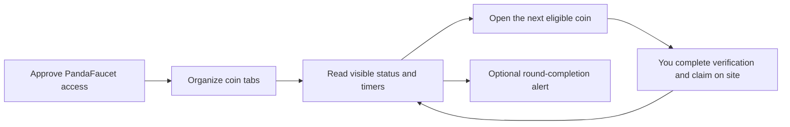

<div align="center">


# modFaucet

### Tiny drops. A tidier browser.

A standalone Chrome side panel for organizing manual faucet claims.

**[Website](https://wearetheartmakers.github.io/modFaucet/)** · **[Download v0.10.1](https://github.com/WeAreTheArtMakers/modFaucet/releases/download/v0.10.1/modFaucet-0.10.1-chrome.zip)** · **[All releases](https://github.com/WeAreTheArtMakers/modFaucet/releases)** · **[Privacy](https://wearetheartmakers.github.io/modFaucet/privacy.html)**

</div>

> **“Damlaya damlaya göl olur.”** — A Turkish proverb: **“Drop by drop, a lake forms.”**
>
> The lake may take a while. Your browser tabs can get organized today.

modFaucet adds a FireFaucet workspace alongside twelve PandaFaucet coin pages: grouped tabs, visible cooldowns, and a **Next coin** button. You complete verification and the final claim on the original provider website.

## At a glance

| | Current public edition |
|---|---|
| Release | **v0.10.1 · Public preview** |
| Browser | Chrome desktop **120+** |
| Platforms | Windows, macOS and Linux with supported Chrome |
| Download | **22.6 KB ZIP** · no repository clone required |
| Setup | Chrome’s manual **Load unpacked** flow |
| Runtime | Standalone extension; no Python, local server or companion app |
| Website hosting | GitHub Pages |
| Distribution | Versioned GitHub Release assets with SHA-256 checksums |

## A calmer claim routine

- **One tidy group.** Related coin tabs share a collapsible `modFaucet` group. Existing eligible tabs are reused and new pages open gradually.
- **One-click navigation.** Jump to the next eligible coin. A persistent round cursor helps every eligible page get its turn.
- **Visible cooldowns.** Track the timers reported by the provider. Missing timing information stays unknown.
- **A side panel that stays with you.** Review coin states and open a specific page without searching through a tab bar.
- **Optional completion alerts.** Get notified when no actionable page remains in the current round. Monitoring can continue for the next opportunity.
- **Local control.** Pause monitoring, collapse the group or revoke PandaFaucet access from the panel.

### Twelve coin pages

`DOGE` · `USDT` · `ETH` · `LTC` · `BCH` · `DASH` · `TRX` · `BNB` · `SOL` · `XRP` · `ADA` · `TON`

Availability depends on the provider’s current funding, limits, cooldowns and verification requirements. A displayed reward is an offer; a provider-reported send is not an independently verified receipt.

## How it works



The extension organizes the workflow. **CAPTCHA, final claims and any withdrawal approval remain user actions.** No earnings or payment guarantees are made.

## Built with


| Layer | Technologies | Purpose |
|---|---|---|
| Extension runtime | JavaScript ES modules · Chrome Manifest V3 | Background service worker and packaged page reader |
| Workspace | Chrome Side Panel API · Tab Groups API | Persistent controls and grouped coin pages |
| Scheduling | Chrome Alarms API · local storage | Periodic checks, saved queue state and cooldown deadlines |
| Page observation | Chrome Scripting API · isolated top-frame DOM reads | Read supported visible page states after permission |
| Alerts | Optional Chrome Notifications API | Round-completion messages when enabled |
| Website | HTML5 · CSS3 · vanilla JavaScript | Responsive landing page, install guide and release information |
| Hosting & delivery | GitHub Pages · GitHub Releases · ZIP · SHA-256 | Static site and directly downloadable, versioned packages |

The public edition has **no native messaging bridge or companion-service dependency**. The website uses a buildless static setup.

## Install for Chrome

1. **[Download the extension ZIP](https://github.com/WeAreTheArtMakers/modFaucet/releases/download/v0.10.1/modFaucet-0.10.1-chrome.zip)** and extract it into a permanent folder.
2. Open **`chrome://extensions`** in Chrome.
3. Enable **Developer mode**, select **Load unpacked**, and choose the extracted `modFaucet` folder containing `manifest.json`.
4. Pin modFaucet from Chrome’s Extensions menu and open its side panel.
5. Select **Start your queue** and approve PandaFaucet access when Chrome asks.

**You do not need to clone this repository.** The website’s **Install for Chrome** buttons download the release ZIP directly. Chrome controls installation; clicking a website button cannot silently install the extension.

Keep Chrome open and your computer awake for live page observation. Installation steps are also included as `INSTALL.txt` inside the package.

### Update an existing installation

Download a newer release, replace the files in the **same installed folder**, then click **Reload** on Chrome’s extensions page. Keeping the extension identity and folder preserves the installation’s local settings. Updates are downloaded manually.

## FireFaucet workspace

Select **Connect FireFaucet** and approve its separate optional host permission. Seven official shortcuts reuse supported tabs in the shared group: dashboard, 30-minute faucet, Daily Bonus, Daily Tasks, PTC ads, surveys and offerwalls. Loading tabs are reused as well. No bulk opening or page reload is performed. Results from a page that changes during reading are discarded.

Select **Read visible status** after a supported page loads. The panel shows recognized ACP, Fuel and native Auto Faucet state with the observation time and path. Fields absent from the page stay **Unknown**, and old observations are marked stale. This is an on-demand reader, not continuous FireFaucet monitoring. Revoke FireFaucet independently from PandaFaucet.

FireFaucet's own Auto Faucet is server-side; users start and collect on the provider site. modFaucet never completes ads, surveys, CAPTCHA, claim buttons, conversions or withdrawals. Its tab shortcuts never replace a running session or navigate a rewarded viewer.

Official references, reviewed 24 November 2026: **[FAQ](https://firefaucet.win/faq/)** and **[fair-use terms](https://firefaucet.win/terms/)**. Availability and rewards depend on the provider and eligibility. This is a spare-time learning tool with small, uncertain returns, not mining or an income promise.

## Privacy and permissions

Queue states, quotes, cooldowns, tab identifiers, preferences and referral-consent events stay in **local extension storage**. The public edition has no telemetry or account-collection server.

| Permission | Why it is used |
|---|---|
| `sidePanel` | Display the workspace next to the current page |
| `tabGroups` | Group related coin pages |
| `alarms` | Schedule observation cycles |
| `storage` | Keep settings and queue state locally |
| `scripting` | Read supported pages in an isolated context after site approval |
| `https://pandafaucet.com/*` — optional | Observe the PandaFaucet queue after approval |
| `https://firefaucet.win/*` — optional | Open supported FireFaucet pages and read visible status on request after separate approval |
| `notifications` — optional | Show completion alerts only after you enable them |

The reader does not collect passwords, input values, cookies, wallet keys, CAPTCHA tokens or challenge-frame contents. Website access can be revoked in the panel or Chrome’s extension settings.

**[Read the full privacy notice](https://wearetheartmakers.github.io/modFaucet/privacy.html).**

## Referral transparency

The panel offers optional signup links for **FireFaucet, Final Autoclaim, Lightning Quest and MoonPTC**. New registrations through these links may earn the publisher commissions under each provider’s rules.

- Each opening requires an explicit, initially unchecked consent confirmation.
- Existing account referrers, browsing URLs, cookies and claim payment destinations are not rewritten.
- A local consent or link-open event does **not** verify registration or referral attribution.
- User rewards and publisher commissions remain separate.

No PandaFaucet referral link is currently verified in this edition.

## What this repository contains

```text
modFaucet/
├── index.html                 English landing page
├── styles.css                 Responsive website styling
├── app.js                     Download guide, preview and release metadata UI
├── privacy.html               Public privacy notice
├── downloads.json             Versioned download URLs and checksums
├── SHA256SUMS.txt              Current ZIP checksum
├── assets/                    Branding and documentation illustrations
└── README.md                  Product and installation guide
```

This public repository is the home for the **website and release distribution**. The full desktop application, private development workspace, browser profiles, databases, credentials and personal settings are not published here.

The downloadable extension ZIP necessarily contains the JavaScript, HTML and CSS that Chrome executes. It is a standalone runtime package, not publication of the full desktop application source. GitHub’s automatically generated source archives contain this website; use the **named extension ZIP** under Releases to install modFaucet.

## Release validation

For **v0.10.1**:

- **52 JavaScript tests passed**, including standalone worker startup, permission checks, queue navigation and page-reader cases.
- Archive integrity, module dependencies, included files and private-data exclusions checked.
- Release metadata and the published ZIP verified against the SHA-256 checksum.
- FireFaucet tests cover host/path boundaries, consent, duplicate-tab prevention, read-only extraction and absent values.
- Earlier v0.9.0 website layout and download-flow checks remain documented in its release. The new panel connection, status display, revocation and 360px layout were exercised in a browser with clearly labelled sample data; no console errors or horizontal overflow were observed. The signed-in v5 site’s accessible ACP balance was observed directly, but the installed-extension injection and Auto Faucet/Fuel fields still require an uninterrupted live-account check.

This is a public preview. Fresh-profile installation across every supported operating system and actual provider payouts are not claimed as verified by these checks.

**[Download checksums](https://github.com/WeAreTheArtMakers/modFaucet/releases/download/v0.10.1/SHA256SUMS.txt)** · **[Release notes](https://github.com/WeAreTheArtMakers/modFaucet/releases/tag/v0.10.1)**

## Support and feedback

Found a UI issue, an unsupported page state or a confusing installation step? **[Open a GitHub issue](https://github.com/WeAreTheArtMakers/modFaucet/issues)** with the extension version and a description of the problem. Keep private account details, credentials and wallet secrets out of public issues.

<sub>Independent software. Not affiliated with Google Chrome, FaucetPay or the faucet providers. Direct distribution only; no Chrome Web Store publication.</sub>
